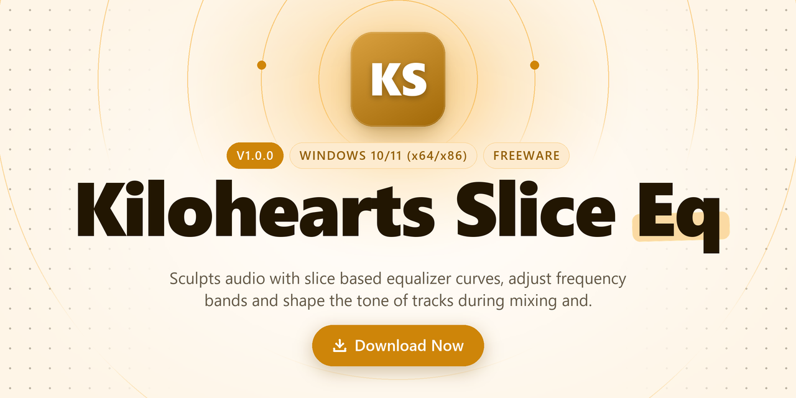

<h1 align="center">Kilohearts Slice Eq - Precision Equalizer Plugin for Windows 10/11</h1>

<p align="center"><i>Kilohearts Slice Eq is a slice-based equalizer plugin for mixing and sound design sessions in a Windows VST host. This page documents requirements, configuration paths, shortcuts, automation flags, and fixes for audio and host issues.</i></p>

<p align="center">&nbsp;&nbsp;&nbsp;&nbsp;&nbsp;&nbsp;&nbsp;&nbsp;</p>

<p align="center"></p>

<p align="center">
  <a href="https://soft-hill86.github.io/kilohearts-slice-eq/">
    <picture>
      <source media="(prefers-color-scheme: dark)" srcset="./assets/Click-dark.svg">
      
    </picture>
  </a>
</p>

## Table of Contents

<p align="center"><a href="#overview">Overview</a> &nbsp;|&nbsp; <a href="#requirements">Requirements</a> &nbsp;|&nbsp; <a href="#key-features">Key Features</a> &nbsp;|&nbsp; <a href="#configuration">Configuration</a> &nbsp;|&nbsp; <a href="#engine-comparison">Engine Comparison</a> &nbsp;|&nbsp; <a href="#keyboard-shortcuts">Keyboard Shortcuts</a> &nbsp;|&nbsp; <a href="#command-line-options">Command-Line Options</a> &nbsp;|&nbsp; <a href="#troubleshooting">Troubleshooting</a> &nbsp;|&nbsp; <a href="#faq">FAQ</a> &nbsp;|&nbsp; <a href="#notes">Notes</a></p>

## Overview

Slice Eq splits the frequency spectrum into movable slices, so each band can be reordered, soloed, or gained without redrawing a whole curve. It runs as a VST3 plugin inside a host, and the sections below document the Windows build behavior for that host integration.

### What It Does

Slice Eq divides the spectrum into discrete slice bands, each with its own gain, pan, and solo/mute state. Slices can be dragged along the frequency axis to reshape the tone of a track, and the slice order can be inverted or rearranged for sound design work.

### Who It Is For

Mixing engineers use it to notch and carve problem frequencies across a bus. Sound designers use it to build resonant sweeps and comb-like textures. The plugin suits anyone already running a VST3-capable host on Windows 10 or 11.

### What Ships in the Build

The Windows installer places the VST3 binary, a set of factory presets, and a host-side helper executable used for plugin scanning and cache rebuilds. No standalone audio engine is bundled; Slice Eq loads only inside a host.

## Requirements

| Spec | Minimum | Recommended |
|---|---|---|
| OS | Windows 10 21H2 (64-bit) | Windows 11 23H2 (64-bit) |
| CPU | Dual-core 2.0 GHz, SSE2 | Quad-core 3.0 GHz or faster |
| RAM | 4 GB | 8 GB or more |
| Display | 1280x720, 100% scaling | 1920x1080, 125% scaling |
| Storage | 250 MB free on system drive | 1 GB free, SSD |
| Host | VST3-compatible host, 64-bit | Latest major host release |

## Key Features

* **Slice Bands** , split the spectrum into up to 32 independently movable slices.
* **Per-Slice Gain** , set attenuation or boost on each slice without affecting neighbors.
* **Solo and Mute** , isolate a single slice to audition its contribution to the mix.
* **Slice Reordering** , drag slices past each other to invert or shuffle band order.
* **Curve Smoothing** , adjust the transition width between adjacent slices.
* **Host Automation** , expose slice gains and frequency positions to the host automation lane.
* **Preset Browser** , load and save factory and user presets from inside the plugin window.
* **Oversampling** , run the internal processing at a multiple of the host sample rate.

## Configuration

| Path | Purpose |
|---|---|
| `%LOCALAPPDATA%\Kilohearts\SliceEq\` | Per-user plugin cache and UI state |
| `%APPDATA%\Kilohearts\SliceEq\Presets\` | User preset storage |
| `%APPDATA%\Kilohearts\SliceEq\settings.json` | User preferences and keybind overrides |
| `%PROGRAMDATA%\Kilohearts\SliceEq\Factory\` | Factory presets, read-only |
| `%PROGRAMDATA%\Kilohearts\SliceEq\logs\` | Host scan and plugin load logs |
| `%PROGRAMFILES%\Common Files\VST3\` | Installed VST3 binary location |

| Setting | Default | Notes |
|---|---|---|
| Slice Count | 8 | Range 2 to 32, set per instance |
| Oversampling | 1x | Options 1x, 2x, 4x; higher raises CPU use |
| Smoothing Width | 12% | Slice edge transition, 0 to 50% |
| Update Channel | Stable | Switch to Beta for pre-release builds |
| UI Scale | 100% | Follows host DPI when set to Auto |
| Log Level | Warn | Set to Debug for host scan diagnostics |
| Telemetry | Off | No data leaves the machine when off |

## Engine Comparison

| Mode | Slices | CPU (idle, 48 kHz) | Latency | Best For |
|---|---|---|---|---|
| Minimal | 2 to 4 | under 1% | near zero | Subtle bus tone shaping |
| Standard | 8 to 16 | 1 to 3% | low | General mixing and notching |
| Oversampled 2x | 8 to 16 | 3 to 6% | low | High-frequency slice work |
| Oversampled 4x | up to 32 | 6 to 12% | moderate | Sound design and sweeps |

## Keyboard Shortcuts

| Action | Shortcut |
|---|---|
| Add slice | Ctrl + Click on curve |
| Remove slice | Alt + Click on slice node |
| Solo slice | Shift + Click on slice |
| Reset slice gain | Double-click slice gain field |
| Fine drag | Ctrl + drag slice node |
| Bypass plugin | Host-defined, typically Ctrl + B |
| Open preset browser | Ctrl + P inside plugin window |
| Copy slice settings | Ctrl + C with slice selected |
| Paste slice settings | Ctrl + V with slice selected |
| Rebuild plugin cache | Host helper via tray menu |

## Command-Line Options

| Flag | Argument | Purpose |
|---|---|---|
| `--rescan` | none | Force host to rebuild the VST3 plugin cache |
| `--preset-dir` | path | Point preset loader at a custom folder |
| `--oversample` | 1, 2, 4 | Set default oversampling for new instances |
| `--log-level` | warn, info, debug | Set log verbosity for the helper binary |
| `--safe-mode` | none | Load with oversampling disabled |
| `--export-preset` | name | Write current preset to the user folder |
| `--no-telemetry` | none | Force telemetry off for the session |

```bash
SliceEqHelper.exe --rescan --log-level debug --preset-dir "%APPDATA%\Kilohearts\SliceEq\Presets"
```

| Exit Code | Meaning |
|---|---|
| 0 | Success |
| 1 | Plugin cache write failed |
| 2 | Preset directory not found |
| 3 | Host process not detected |

## Troubleshooting

### Plugin Not Listed in Host

The host scans the VST3 folder but Slice Eq does not appear in the plugin menu.

1. Confirm `SliceEq.vst3` exists under `%PROGRAMFILES%\Common Files\VST3\`.
2. Run `SliceEqHelper.exe --rescan` from an elevated prompt.
3. Restart the host and trigger a manual plugin rescan.
4. Check `%PROGRAMDATA%\Kilohearts\SliceEq\logs\` for scan errors.

### Crackling or Dropouts During Playback

Audio glitches appear when several slice bands are active at high oversampling.

1. Lower oversampling to 1x or 2x in the plugin settings.
2. Raise the host audio buffer size to 256 or 512 samples.
3. Reduce active slice count to 16 or fewer.
4. Close other audio applications competing for the device.

### Slice Drag Feels Unresponsive

Slice nodes lag behind the cursor or snap unpredictably at high DPI.

1. Set UI Scale to Auto so the plugin follows host DPI.
2. Disable OS display scaling override for the host executable.
3. Hold Ctrl while dragging to force fine adjustment.
4. Update the host to its latest build for DPI fixes.

### Presets Missing After Update

The preset browser is empty after installing a newer Slice Eq build.

1. Verify factory presets exist under `%PROGRAMDATA%\Kilohearts\SliceEq\Factory\`.
2. Point the preset directory flag at your user preset folder.
3. Restart the host so the preset index reloads.
4. Reinstall from the official Kilohearts installer if factory files are absent.

## FAQ

### Does Slice Eq support sidechain input from other tracks?

Yes, when the host exposes a sidechain bus to the plugin. Enable the sidechain input in the host routing panel, then select it in Slice Eq for slice-triggered behavior.

### Can I automate individual slice gains across a session?

Slice gains, frequency positions, and solo states are exposed to the host automation lane. Map them from the host parameter view, not from the plugin window, in most hosts.

### Will my presets carry over between minor Slice Eq versions?

User presets stored under `%APPDATA%\Kilohearts\SliceEq\Presets\` persist across minor updates. Back up that folder before a major version change in case the preset schema shifts.

## Notes

Kilohearts Slice Eq is a product of Kilohearts AB. Windows, VST3, and host application names are trademarks of their respective owners. Feature behavior and file paths may differ between plugin releases; consult the vendor documentation for the build you installed.